<p align="center">
  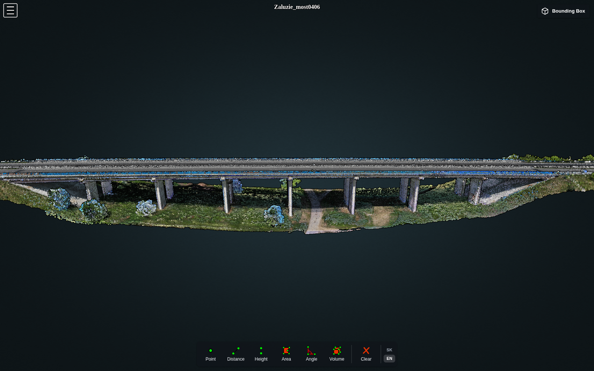
</p>

# opcviewer

**Share point clouds with your clients as a link: a self-hosted Potree viewer with an admin panel.**

opcviewer turns LAS/LAZ scans into web pages that open in any browser: no software to install and no account to create. Upload a scan in the admin panel. It is converted with PotreeConverter, gets a page at `https://your-server/<project>/` and a thumbnail, and you copy the link to your client. They can walk around the model, measure distances, heights, areas and stockpile volumes, and cut it open with a section box.

Built by a land surveyor for drone and laser scans of buildings, bridges, quarries and construction sites, and in daily use for client deliveries since 2026. It runs on one small Linux server, at the office or in the cloud, and you decide how it is reached from the internet.

> **Version 2.0.0** · one-command install on Ubuntu 22.04 / 24.04 or Debian 12 · [AGPL-3.0](LICENSE)

---

## The goal

Point clouds from drones and laser scanners are big (gigabytes per project). Clients rarely have the software to open them. Sending the files is slow, and a set of screenshots doesn't let anyone check a distance or a volume themselves.

[Potree](https://github.com/potree/potree) already solves the hard part: it streams a converted point cloud into the browser, level by level, so a 14 GB scan opens in seconds. What it leaves to you is everything around it: running the converter, writing a page per project, copying folders to a web server, keeping links working and knowing whether anyone opened them. **opcviewer is that missing part,** plus the tools clients actually ask for.

## Highlights

- **Upload and share.** Drop one or more LAS/LAZ files in the admin panel and watch the conversion live. When it's done, "Copy link" gives you the address to send. Projects can be renamed, re-titled and tuned (point budget, point size and shape, background, Eye-Dome-Lighting, which sidebar menus show). Deleted projects go to a trash first.
- **Measuring toolbar for clients.** Point coordinates, distance, height, area, angle and **volume** sit in one bar at the bottom of every page. Potree 1.8's own measuring places every point on top of the first in current browsers; opcviewer fixes that.
- **Stockpile and excavation volumes.** Click around the foot of a pile and the result shows volume above and below the base plane, net volume, area and tonnes for a given density. The calculation runs on the server, which reads the scan from its own disk, so it takes seconds even on a slow connection. The measured cells are draped in green (fill) and red (cut) over the model.
- **Object snap (OSNAP).** Like in AutoCAD: measuring points snap to end points, midpoints, perpendiculars, intersections and the nearest point on a line of what is already measured, each switchable in a bar at the right edge (F4 for all).
- **Section box.** A Bounding Box tool, modelled on the one in 3Dsurvey, cuts the model to a box that you drag, rotate and step with the mouse and keyboard. Click again to hide the box and keep the cut, for looking inside a building.
- **Your branding.** Company name, website, a link to your user guide, logo, browser-tab icon, accent colour and the default language (English or Slovak) are set in the admin panel and apply to every project page at once. With nothing set, pages stay plain.
- **View counts and real load times.** Every project card shows how often it was opened and how long it took visitors to see the first points and the whole model, read from Apache's log and a tiny report each page sends after loading. Search engines, link previews and your own thumbnail renders are not counted.
- **Thumbnails.** Each project gets a real screenshot of its 3D view, made in headless Chrome.
- **Robust streaming.** A patched Potree loader recovers from stalled or failed downloads instead of freezing after a few of them. That failure happens on real connections through tunnels and mobile networks.

## Screenshots

| Quarry | Volume of a pit | House |
|:---:|:---:|:---:|
| 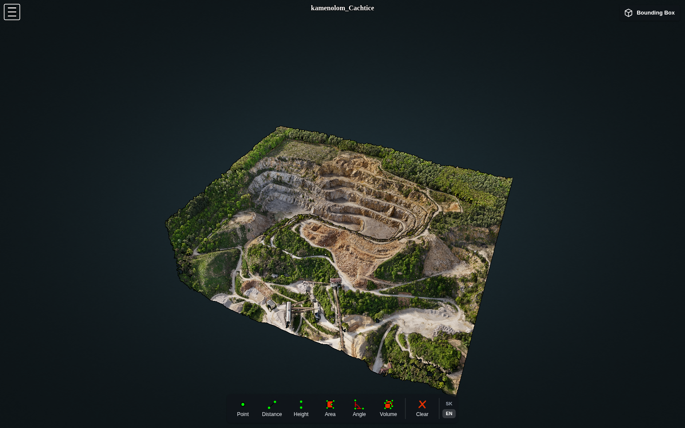 | 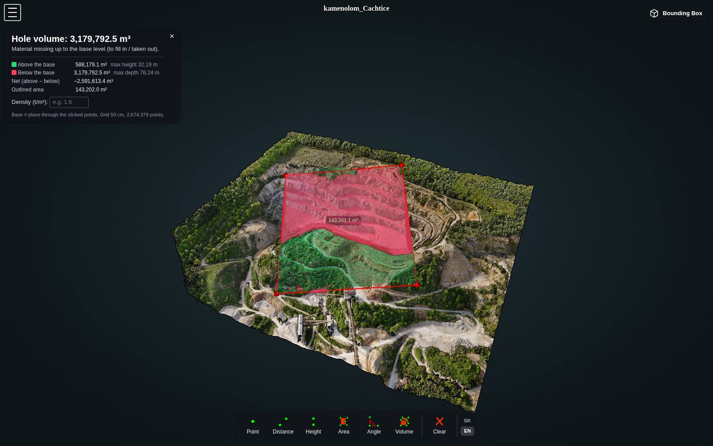 | 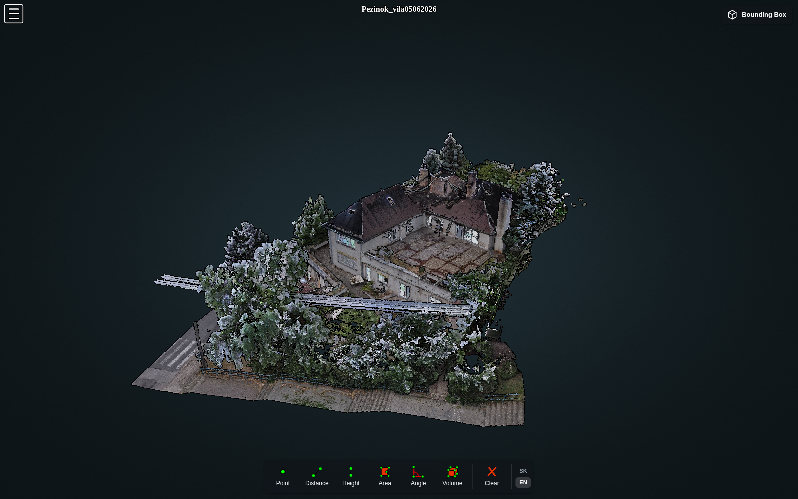 |
| **Bounding Box** | **Rail bridge** | **Your branding** |
| 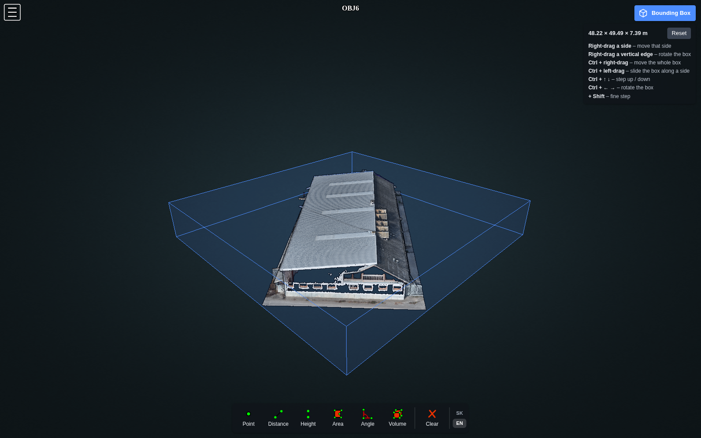 | 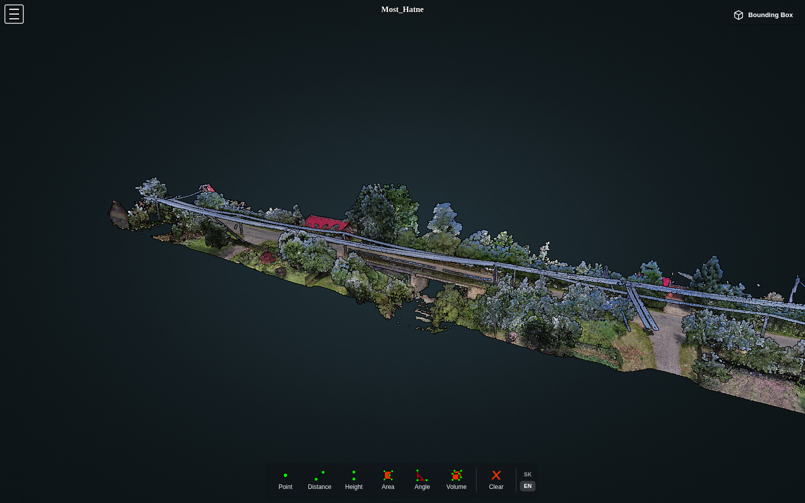 | 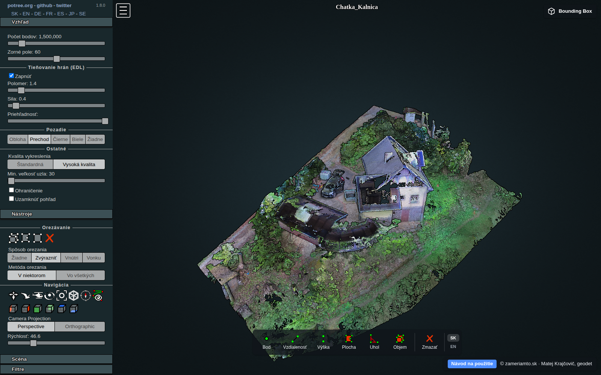 |
| **Admin: projects** | **Admin: branding** | **Admin: project settings** |
| 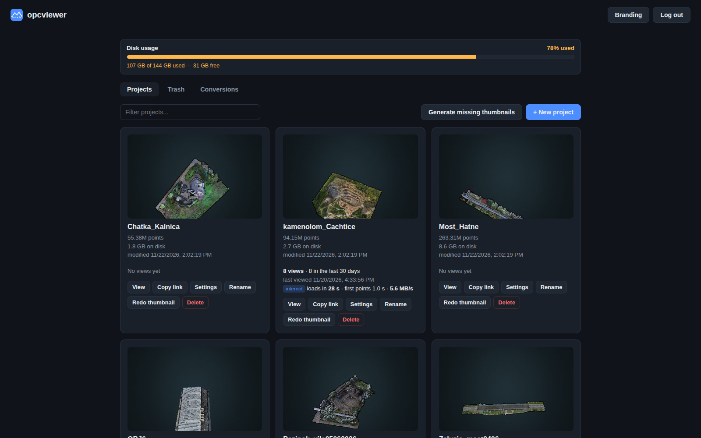 | 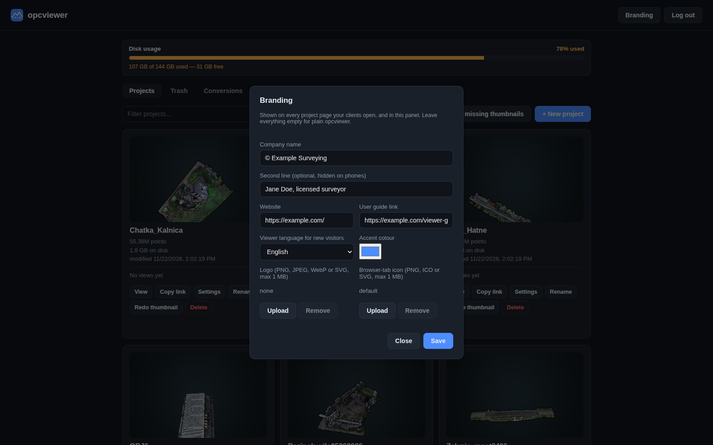 | 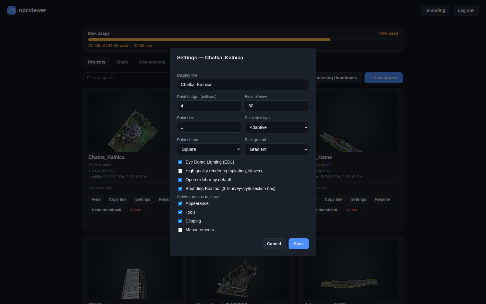 |

*Real projects from the author's server (drone photogrammetry). "Your branding" shows the Slovak interface with the author's own branding.*

## How it works

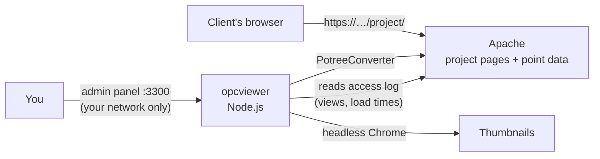

1. **You upload a scan** in the admin panel. opcviewer runs PotreeConverter on it, writes the project folder into Apache's web root and generates the page from your settings.
2. **Apache serves the pages and the point data** as plain files. The viewer downloads only the parts of the octree it needs, using HTTP range requests, so the admin app is not involved when a client looks at a model. The one exception is the **volume calculation**: Apache passes exactly `POST /opcviewer-api/volume` to the app, which reads the points from disk and returns the result; nothing else of the app is reachable through Apache.
3. **Viewer scripts** (`viewer/`) add the toolbar, the volume tool, the Bounding Box, branding and translations to Potree on every page. Branding is read from one small JSON file, so changing it updates all projects without regenerating any page.

The details (page generation, the loader fix, how volume is computed, how statistics are collected) are in [docs/ARCHITECTURE.md](docs/ARCHITECTURE.md).

## Measured

| | |
|---|---|
| Projects on the author's server | 42, from 105 MB to 14 GB each |
| Visitors over the internet (median of 37 visits) | first points after **1.9 s**, model fully loaded after **9.2 s**, 1.8 MB/s |
| Converting a 3.7 MB LAS (110 000 points) in the test install | about 6 s, 2 CPU cores |
| Test install on a fresh Ubuntu 24.04 container (2 GB RAM) | installer finished, converted, served and made a thumbnail without changes by hand |

## Get started

### Install

On a fresh **Ubuntu 22.04 / 24.04 or Debian 12** server (x86_64, 2 GB RAM or more, disk space for your scans):

```bash
curl -fsSL https://raw.githubusercontent.com/matejkrajcovic111-ctrl/opcviewer/main/install.sh | sudo bash
```

The installer sets up Node.js, PotreeConverter, Apache and the `opcviewer` service, then prints the admin address and a **one-time setup code**. Open the admin panel, enter the code and choose your password. Run the same command again later to update; projects, settings and the password are kept.

Options (ports, folders), what gets installed where, and how to uninstall: **[docs/INSTALL.md](docs/INSTALL.md)**.

### Put it online

The project pages are plain web pages on port 80 and can be published in whatever way suits you: on your local network only, through a Cloudflare Tunnel, behind your own reverse proxy with HTTPS, or over Tailscale. Each option is described step by step in **[docs/INSTALL.md → Going online](docs/INSTALL.md#going-online)**. Keep the admin panel (port 3300) on your own network.

### Use it

Uploading, sharing, settings, measuring, volumes, the Bounding Box and branding: **[User guide](docs/USER_GUIDE.md)**.

## Tech stack

| | |
|---|---|
| Server | Node.js 24, Express 4, `multer` uploads, `express-session` with file store, bcrypt |
| Admin panel | Plain HTML, CSS and JavaScript, no build step |
| Viewer | Potree 1.8 (as shipped with PotreeConverter 2.1.2) with a patched loader and three opcviewer scripts |
| Conversion | PotreeConverter 2.1.2 (Linux build), optional Brotli encoding |
| Thumbnails | Puppeteer with headless Chrome |
| Web server | Apache 2.4 with an `.htaccess` for CORS, MIME types and cache headers |
| Install | One shell script with pinned, SHA-256-checked downloads, systemd service |
| Quality | Node test runner (configuration, branding, page generation, statistics, volume maths on known shapes), shellcheck, gitleaks and `npm audit` in CI |

```
server.js   Express app: routes, auth, uploads
lib/        configuration, projects, conversion queue, page template, branding,
            statistics, thumbnails
public/     admin panel (login, projects, settings, branding)
viewer/     scripts copied into potree_libs/: toolbar, volume, Bounding Box, branding,
            Slovak translation, the Potree loader patch
web/        Apache site, .htaccess and the landing page
install.sh  installer and updater
test/       unit tests (node --test)
docs/       documentation, decisions log, screenshots
```

## Documentation

- [User guide](docs/USER_GUIDE.md): projects, sharing, measuring, volumes, Bounding Box, branding, statistics
- [Install](docs/INSTALL.md): installer options, going online, updating, backups, uninstalling
- [Architecture](docs/ARCHITECTURE.md): how the pieces fit and why
- [Development](docs/DEVELOPMENT.md): running locally, tests, CI, screenshots
- [Decisions log](docs/DECISIONS.md): non-obvious decisions with the reasoning
- [Plan](docs/PLAN.md) and [Changelog](CHANGELOG.md)

## Licence

opcviewer is free software: you can redistribute it and/or modify it under the terms of the **[GNU Affero General Public License](LICENSE)** as published by the Free Software Foundation, either version 3 of the License, or (at your option) any later version. It is distributed in the hope that it will be useful, but without any warranty; without even the implied warranty of merchantability or fitness for a particular purpose.

In short: you may use, study, change and share opcviewer. If you run a modified version as a service for others, you must offer them its source under the same licence.

## Third-party software

[Potree](https://github.com/potree/potree) and [PotreeConverter](https://github.com/potree/PotreeConverter) (BSD-2-Clause, Markus Schütz), and the libraries bundled with Potree (three.js, jQuery, OpenLayers, proj4 and others, each under its own licence, see `potree_libs/` after installation). Node.js packages: Express, multer, bcrypt, express-session, session-file-store and Puppeteer (MIT / Apache-2.0). The installer downloads Potree and Node.js from their official releases; they are not part of this repository.

opcviewer sends no data anywhere. Load times are reported only to your own server.

---

### Po slovensky

**opcviewer** je prehliadač mračien bodov na vlastnom serveri. Nahráte sken (LAS/LAZ) v administrácii, opcviewer ho skonvertuje a vytvorí stránku, ktorej odkaz pošlete klientovi. Klient si model otvorí v prehliadači bez inštalácie, môže v ňom merať vzdialenosti, výšky, plochy a objemy depónií či výkopov a orezať ho Bounding Boxom. Rozhranie prehliadača je po slovensky aj po anglicky, logo, názov firmy, odkaz na návod a farbu si nastavíte v administrácii. Inštalácia jedným príkazom na Ubuntu alebo Debian.

Made by [zameriamto.sk](https://zameriamto.sk) · © 2026 zameriamto.sk · [AGPL-3.0-or-later](LICENSE)
