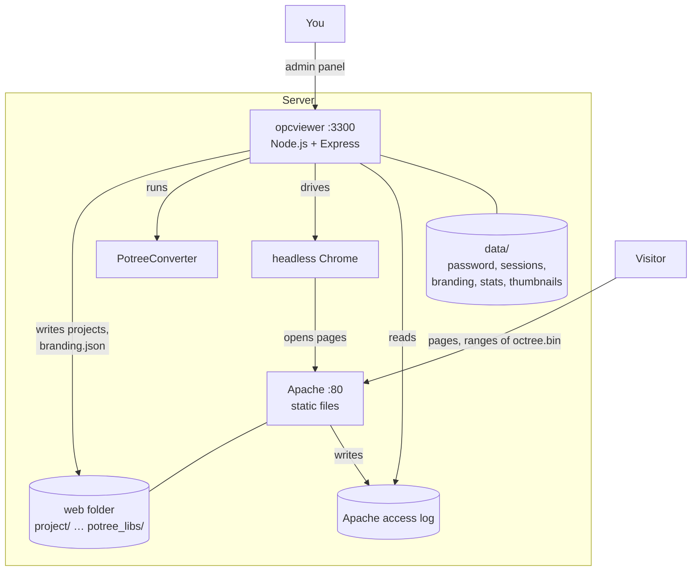

# Architecture

## Overview



Two processes with a clear split:

- **Apache** serves everything a visitor needs as plain files: the project page, Potree and its libraries, the opcviewer scripts, `metadata.json`, `hierarchy.bin` and byte ranges of `octree.bin`. Nothing dynamic happens when a client views a model, so viewing scales with Apache, not with Node.
- **opcviewer** (Node.js, `server.js`) is the admin panel: upload, conversion queue, page generation, branding, statistics, thumbnails. It writes into the web folder and is never contacted by visitors.

## Projects

A project is a folder in the web root:

```
<www>/Bridge_2026/
    index.html                 the page (generated by lib/template.js)
    .manager-settings.json     its settings
    pointclouds/index/         PotreeConverter output: metadata.json, hierarchy.bin, octree.bin
```

`lib/projects.js` lists them by scanning the web root. Projects that existed before opcviewer managed them may keep their metadata in other places (`pointclouds/metadata.json`, `pointclouds/<name>/metadata.json`), and `locateMetadataRelPath()` finds any of them. Such a project's hand-written `index.html` is left alone until you first save its settings or rename it; then it is generated from the template like every other page.

**Conversion** (`lib/convert.js`): multer stores the upload in `uploads/`, a single-worker queue runs `PotreeConverter <files> -o <project>/pointclouds/index [--encoding BROTLI]` with `LD_LIBRARY_PATH` set to the converter's own folder (it bundles `liblaszip.so`), streams its output to the browser over Server-Sent Events, writes `index.html` and settings, deletes the upload and queues a thumbnail.

**Pages** (`lib/template.js`) are generated from the project's settings. Each loads Potree from `../potree_libs/` and, after it, the opcviewer scripts: `opcviewer-branding.js`, `opcviewer-ui.js` and, if the project has the Bounding Box on, `opcviewer-bbox.js`. Pages contain no branding, so changing branding never rewrites a page. A test (`test/template.test.js`) compares generated pages byte for byte against golden copies.

## The viewer scripts

They live in `viewer/` and the installer copies them into `potree_libs/`. They work without a build step on top of the stock Potree 1.8 page.

### `opcviewer-branding.js`

Fetches `potree_libs/opcviewer/branding.json` (written by the admin panel, `lib/branding.js`). From it, the script sets the bottom-right badge, the browser-tab icons, the default language and the CSS accent colour variables `--opcv-accent`, `-hover`, `-light`, `-text`. Other scripts read `window.opcvBranding` and wait on `window.opcvBrandingReady`, which always resolves within 1.5 s (with defaults if the file is missing). The badge is built with DOM text nodes, never HTML, so a company name can't inject markup.

### `opcviewer-ui.js`

- **Language.** Potree calls `viewer.setLanguage('en')` from every page. The script replaces `Potree.Viewer.prototype.setLanguage` so that call applies the visitor's choice (stored in `localStorage`) or else the branding default. Slovak covers Potree's i18next keys (`SK` table, also written out as `resources/lang/sk/translation.json` by `viewer/gen-sk.js`) plus texts Potree hard-codes in English, replaced by exact match through a MutationObserver.
- **Measuring toolbar.** It calls `viewer.measuringTool.startInsertion` with the same arguments as Potree's sidebar icons, and hides that sidebar block. It also **repairs Potree 1.8's measuring in current browsers.** The measuring tool's `mouseup` handler is a capture listener on the canvas, the input handler's a bubbling one. Browsers now run capture listeners on the target first, so the input handler runs last and drops the point the tool had just started dragging, and every point lands on the first. A bubbling listener on the canvas's parent picks the point up again.
- **Volume** (`computeVolume`). The page posts the outline to `/opcviewer-api/volume` and draws the highlight from the height grid that comes back (`zmDecodeHighlight`); see *Server-side volume* below. If that fails (no proxy, busy, offline), or with `window.zmVolumeMode = 'browser'`, the same calculation runs in the browser: inputs are the outline polygon and the points under it, read straight from the octree (`gatherPoints`). It loads the nodes over the outline down to the level the grid needs, so the result doesn't depend on what happens to be drawn. The base is a least-squares plane through the clicked points. The grid cells are 5 cm (smaller outlines: about 400 across, at least 1 cm); only an outline whose bounding rectangle would need more than 16 million cells (about 40 000 m²) gets the finest size that fits, up to 50 cm. The browser fallback aims for 1.5 million cells (4 million at most), so it can be coarser than the server; each cell holds the mean height of its points relative to the plane. If more than 8 % of cells are empty, the grid is made coarser until the data fills it; remaining gaps are filled from neighbours. Volume above and below the plane is summed separately. The highlight is one quad per cell at the height used, plus a red "lid and walls" mesh for dug-out space, drawn after the point cloud without depth test. Vertices are relative to the grid corner, because national grid coordinates are too large for 32-bit floats. The grid maths lives in `opcviewer-grid.js` (loaded on demand in the browser as `window.zmVolumeGrid`, `require`d by the server) and is tested on a cone and a pit (`test/volume.test.js`). No grid is larger than 16.5 million cells (about 850 MB on the server, measured).
- **Sidebar and cube.** `zmCleanSidebar` replaces Potree's header with opcviewer and its version (from `branding.json`) and removes About, the language list, Tools → Clipping and the *Box*/*Lock view* switches. `renderer.setViewport` is wrapped so the navigation cube is drawn below the Bounding Box (`zmNavCubeViewport`); clicks on it reach Potree with `clientY` shifted. `window.zmTopRightBottom()` tells the OSNAP bar how far that stack reaches.
- **Load report.** Once a page has finished loading (no node loading for 1.5 s), it requests `potree_libs/opcviewer-stat.gif?s=<project>&f=<ms to first points>&l=<ms to fully loaded>&b=<bytes>&d=<ms downloading>&h=pub|lan`. The image is one transparent pixel; only the line in Apache's log matters.

### `opcviewer-osnap.js`

Loaded by `opcviewer-ui.js`. `zmOsnap.pick(cursor, segments, points, prev, enabled, project, surfaceZ)` is pure (tested in `test/osnap.test.js`): the closest End/Mid/Perp/Int target within 12 px, ties in that order End, Int, Mid, Perp; Nearest only when none of those is in reach (ternary search along the segment in 3D, so it is exact on screen in perspective). F4 toggles. In the page, a bubbling `mousemove` on the canvas's parent (after Potree moved the point to the cloud) moves the point being placed onto the target; a capturing `mouseup` makes sure it is still there when Potree places it. Settings in `localStorage` (`zm-osnap`).

### `opcviewer-bbox.js`

A Potree `BoxVolume` with `clip = true` and the clip task set to *show inside*. Mouse events are caught in the capture phase on the canvas's parent, so a drag that starts on the box never reaches Potree's camera controls. All picking happens in the box's own coordinate system, so it keeps working after rotation. Potree's own picking is switched off for this box (no transform gizmo). The initial fit uses the `position` range from `metadata.json`, because Potree 2's bounding box is the cubic octree root, e.g. 49 m tall for a 7 m tall building. THREE is bundled inside `potree.js` and not exported, so the script takes `Vector3` and `Matrix4` from existing objects' constructors.

### The Potree loader patch

`viewer/patch_potree.py` changes Potree's `NodeLoader` in `potree.js`. Stock Potree allows 4 parallel node downloads and frees a slot only on success. A request that hangs (no timeout), returns an error page (no status check) or whose decoder worker throws (no `onerror`) holds its slot forever, so four such events and the viewer never loads more detail. They do happen on long connections through tunnels and proxies. The patch adds a 20 s timeout, status and length checks and a worker error handler, all freeing the slot, and allows 8 parallel downloads. It refuses to run on a file that doesn't match what it expects.

**Never call `load()` on an empty Potree 2 node** (`numPoints` 0): its decoder never answers, the node stays "loading" and its slot is gone. The volume tool skips such nodes and walks their children from the hierarchy instead.

## Server-side volume

`POST /opcviewer-api/volume` with `{project, outline: [[x, y, z], …]}`. It is registered before the session middleware and is the only route Apache proxies (`web/apache-site.conf`). `lib/volumeService.js` validates (existing project folder, 3–500 finite points, grid ≤ 16.5 million cells, body ≤ 64 KB) and runs one calculation at a time in a fresh worker thread (`lib/volumeWorker.js`, 1 GB heap limit), up to 4 waiting (then 429), at most 90 s from arrival including the wait (then 504, before Cloudflare's 100 s), and is dropped or stopped when the visitor disconnects. An unknown project is 404, which makes the page calculate in the browser. Everything else under `/opcviewer-api` gets a plain 404 before the session middleware; Apache forwards only an exact `POST` (`ProxyPassMatch` on the full path, `LimitExcept POST`). An outline that misses the cloud's box is answered without building its grid, and the grid's inside test runs row by row (cells + edges per row). `lib/octree.js` reads Potree 2 octrees from disk (hierarchy with proxy chunks, DEFAULT and BROTLI positions, mirroring Potree's own decoders); `lib/volume.js` walks the nodes over the outline exactly like the browser's `gatherPoints` and feeds the shared grid. The answer has the numbers, the base plane and the highlight as base64 Float32 heights plus a bit mask (2 × 2 cells merged until ≤ 250 000). On three real projects (DEFAULT and BROTLI) server and browser results were identical or within 0.014 %.

## Statistics

`lib/stats.js` reads Apache's access log incrementally by inode and byte offset, when the project list is opened and every 10 minutes. On the first run it also reads the rotated logs. It counts:

- **views**: a 200/304 `GET /<project>/` or `/<project>/index.html`;
- **load reports**: the `opcviewer-stat.gif` requests (and `zm-stat.gif`, their name before 2.0).

It skips `127.0.0.1` (thumbnails) and user agents of crawlers and link previews. Totals and the last 60 load reports per project are kept in `data/stats.json`, because Apache keeps only about two weeks of logs. A rename moves a project's history to the new name.

Apache's log has no durations, and changing its format would need root, so load times come from the visitor's browser. The browser knows when the points actually appeared, which no server log can tell.

## Thumbnails

`lib/thumbnails.js` keeps one headless Chrome (Puppeteer). It opens `OPCV_LOCAL_URL/<project>/`, waits for the first points, hides the toolbar, badge and panels, and screenshots the largest canvas (Potree also has a tiny hidden minimap canvas). One worker, one project at a time. If Chrome can't start, the job fails with the reason instead of retrying.

## Admin panel and security

- One admin password (bcrypt) in `data/config.json`, set on first use. The installer writes a one-time **setup code** (`data/setup-code.txt`) that `POST /api/setup` requires, so nobody else on the network can set the password first. Sessions are files in `data/sessions/`, so they survive restarts; the cookie lasts 30 days.
- Every route except login, setup, the login page's assets and `POST /opcviewer-api/volume` requires a session. `express.static` runs after the auth gate, so a new asset for the login page must be added to `OPEN_PATHS` explicitly.
- Branding input is validated (lengths, `http(s)` links, `#rrggbb` colours, icon paths limited to site paths). Uploaded images are checked by their content, not their name. SVGs with scripts, event handlers, embedded pages, character references or entity declarations are refused, and all uploaded images are served with `Content-Security-Policy: default-src 'none'; sandbox` and `nosniff` (by the admin panel and by `.htaccess`), so whatever got past the filter still can't run.
- **Install layout:** code, Node.js and the converter are owned by root and read-only for the service user `opcviewer`, which owns only what it writes: the web folder, `data/`, `uploads/`, `trash/`. The installer writes into those folders as that user, so a link planted there can't make root overwrite a system file. Apache allows `.htaccess` only `FileInfo` and `Options=Indexes`, and follows links only when owners match.
- Project pages have no access control: the link is the key. See [INSTALL.md](INSTALL.md#going-online) for keeping the admin panel private.

## Configuration

`lib/config.js` reads every installation-specific value from `OPCV_*` environment variables (systemd loads them from `/etc/opcviewer/opcviewer.env`); see [INSTALL.md](INSTALL.md#settings). Defaults fit a standard install, and the code contains no host names or personal paths.
