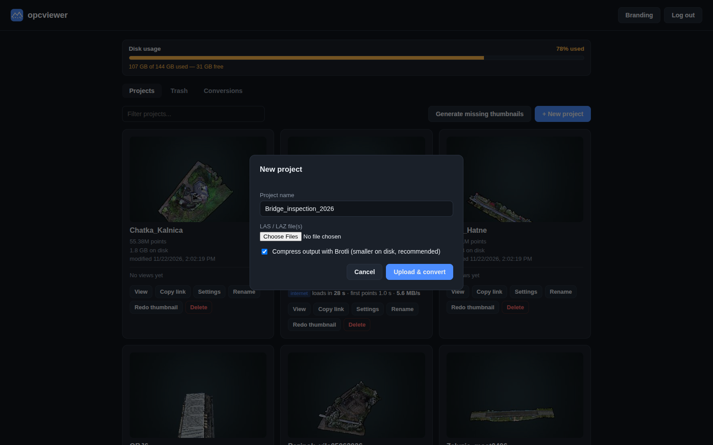
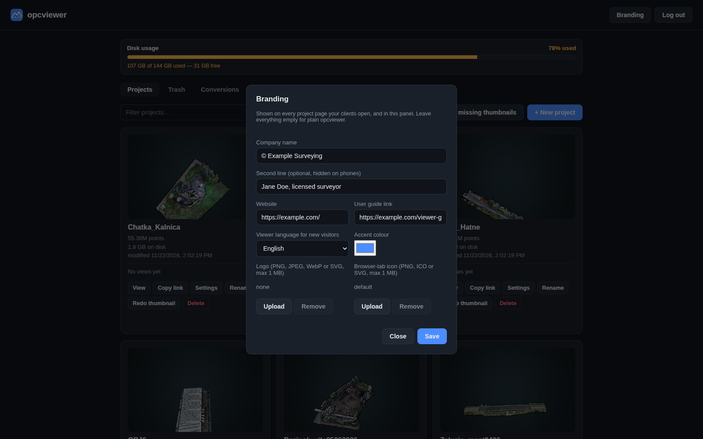
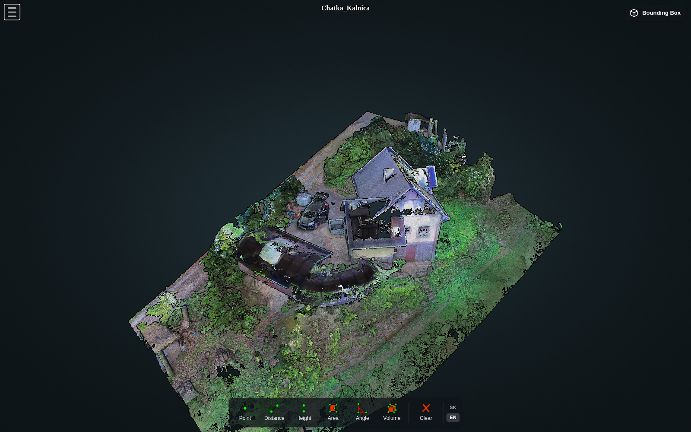
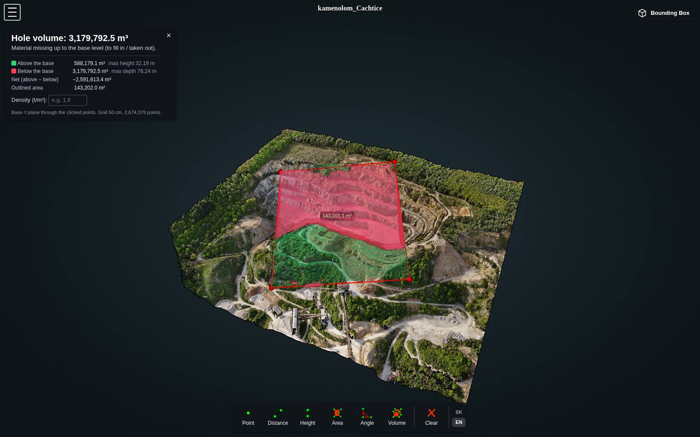
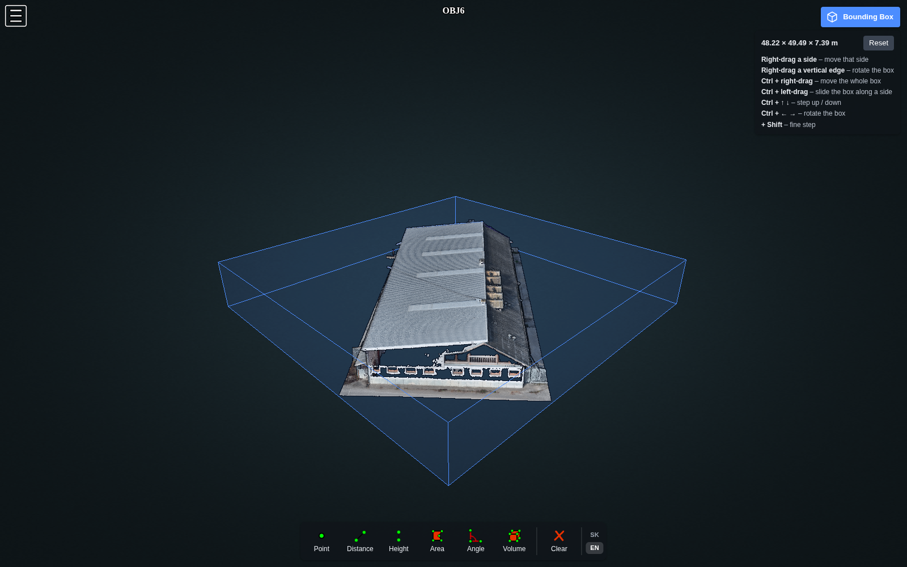

# User guide

opcviewer has two sides: the **admin panel**, where you upload and manage projects (only you use it), and the **project pages**, the links your clients open.

## Contents

- [Signing in](#signing-in)
- [Adding a project](#adding-a-project)
- [Sharing a project](#sharing-a-project)
- [Project settings](#project-settings)
- [Renaming, deleting and the trash](#renaming-deleting-and-the-trash)
- [Thumbnails](#thumbnails)
- [Views and load times](#views-and-load-times)
- [Branding](#branding)
- [The project page](#the-project-page): navigation, measuring, volumes, Bounding Box, language

## Signing in

Open the admin panel at the address the installer printed, e.g. `http://192.168.1.20:3300/`.

- **First time:** enter the **setup code** from the end of the installer's output and choose a password of at least 8 characters. The code works once; it stops anyone else on your network from setting the password before you do. Lost it? It is in `/opt/opcviewer/data/setup-code.txt` until the password is set.
- **Afterwards:** the password only. You stay signed in for 30 days, also across restarts.

There is one admin password. To reset it, stop the service, delete `/opt/opcviewer/data/config.json`, run the installer again (it prints a new setup code) and set a new password.

## Adding a project

1. **+ New project**.
2. **Project name**: it becomes the address, so `Bridge Inspection 2026` turns into `/Bridge_Inspection_2026/`. Letters, numbers, `-` and `_` are kept; other characters become `_`.
3. **LAS / LAZ file(s)**: one or more files of the same scan. Several files are merged into one point cloud.
4. **Compress output with Brotli** (on by default): about half the disk space and download size, slightly more work for the visitor's browser. Leave it on unless you have a reason not to.
5. **Upload & convert**. The upload bar shows the transfer; then the **Conversions** tab shows PotreeConverter's log live. When it says *Done*, the project appears in **Projects** and a thumbnail is made a few seconds later.

Files up to 30 GB each are accepted. Conversion time grows with the number of points: a few seconds for a small file, tens of minutes for a scan of a billion points. Converting needs free disk space of roughly the size of the input files, on top of the upload itself, which is deleted afterwards.

## Sharing a project

Each project card has **View** (opens the page) and **Copy link**. The link uses the public address set as `OPCV_PUBLIC_URL` (see [INSTALL.md](INSTALL.md#settings)). If that is empty, it uses the address you opened the admin panel at, which is right only on your own network.

The link is the only protection a project page has: anyone who has it can open the project, and project names are not listed anywhere. Treat links to sensitive projects accordingly.

## Project settings

**Settings** on a card:

| Setting | What it does |
|---|---|
| Display title | Shown at the top of the page and in the browser tab |
| Point budget | How many points (in millions) the viewer draws at once. Higher = denser, needs a better graphics card |
| Field of view | Camera angle in degrees |
| Point size, Point size type | Adaptive grows points where the cloud is sparse; Fixed keeps one size |
| Point shape | Square (faster) or Circle |
| Background | Gradient, Skybox, Black, White or None |
| Eye Dome Lighting | Shading that makes edges and depth readable; usually on |
| High quality rendering | Smoother splats, slower |
| Open sidebar by default | Whether Potree's sidebar is open when the page loads |
| Bounding Box tool | Adds the Bounding Box button to this project's page |
| Sidebar menus to show | Appearance, Tools, Clipping, Measurements |

Saving a setting rewrites the project's page (`index.html`). Pages that were made by hand before opcviewer managed them are replaced the first time you save a setting or rename the project.

## Renaming, deleting and the trash

- **Rename** changes the folder and therefore **the link**: links you sent before stop working. View counts and load times move with the project.
- **Delete** moves the project to the **Trash** tab, away from the web folder: its link stops working, but nothing is lost. **Restore** brings it back; **Delete permanently** frees the disk space.
- The bar at the top shows how full the disk is.

## Thumbnails

Made automatically after each conversion: headless Chrome opens the project page on the server and photographs the 3D view. **Generate missing thumbnails** makes them for projects that have none (for example ones copied in by hand), and **Redo thumbnail** on a card makes a new one, for example after you changed the project's colours.

## Views and load times

Each card shows:

- **Views**: how often the page was opened, in total and in the last 30 days. Counted from Apache's access log; crawlers, link previews (messengers, social networks) and the server's own thumbnail renders are left out. Your own visits do count.
- **Load times**: when a visitor's page has finished loading, it reports how long it took until the first points were visible and until nothing was loading any more, and how fast the data came in. The card shows the median of the recent visits, separately for visitors over the internet and on your own network (a page opened by IP address). Pages opened in a background tab report nothing.

Apache keeps its log for about two weeks; opcviewer stores the totals in `data/stats.json`, so they keep growing beyond that.

## Branding

**Branding** (top right) sets what every project page shows, all at once and without touching the pages:

| Field | Shown as |
|---|---|
| Company name | Text in the bottom-right badge, linked to your website |
| Second line | After the name, hidden on phones (e.g. your name and profession) |
| Second line in English | Used instead on English pages (e.g. *surveyor* instead of *geodet*); empty = the line above everywhere |
| Website | Link of the name and logo |
| User guide link | A button in the badge (*User guide* / *Návod na použitie*) |
| Viewer language for new visitors | English or Slovak; visitors can switch, and their choice is remembered |
| Accent colour | Buttons, the active tool, the Bounding Box frame |
| Logo | Small image in the badge (PNG, JPEG, WebP or SVG, up to 1 MB) |
| Browser-tab icon | The favicon of the project pages (PNG, ICO or SVG) |

Leave everything empty for plain opcviewer pages without a badge. The admin panel's own header, tab title and colour follow the branding too.

## The project page

### Moving around

| | Mouse | Touch |
|---|---|---|
| Rotate | left-drag | one finger |
| Pan | right-drag | two fingers |
| Zoom | wheel | pinch |
| Fly to a spot | double-click | |

The ☰ button opens Potree's sidebar: appearance, clipping, navigation modes, scene and filters. Its header shows the opcviewer version. The navigation cube and compass (sidebar → Navigation) appear below the Bounding Box button.

### Measuring

The toolbar at the bottom: **Point** (coordinates of one point), **Distance**, **Height**, **Area**, **Angle**, **Volume** and **Clear**. Click points on the model; right-click finishes a distance, area or volume. **Esc** cancels the measurement being placed. Points of a finished measurement can be dragged. Coordinates and lengths are in the units of the scan, usually metres in the scan's coordinate system.

### Object snap (OSNAP)

The bar at the right edge makes measuring points snap, as in AutoCAD, to what is already measured (any measurement on the page, including the one being drawn):

| | Snaps to |
|---|---|
| □ **Endpoint** (*Koncový bod*) | a point of a measurement, exactly |
| △ **Midpoint** (*Stred*) | the middle of a segment |
| ⊥ **Perpendicular** (*Kolmo*) | the foot of the perpendicular from the previous point onto a segment, in plan; height along that segment |
| ✕ **Intersection** (*Priesečník*) | where two segments cross in plan; height from the scan's surface there (or the mean of the two segments) |

When the cursor comes within 12 pixels of such a spot, a yellow marker and its name appear and the point jumps there; click to place it. Each type is switched on and off with its own button; **OSNAP** at the top (or **F3**) switches snapping off and on without forgetting which types were chosen. Default: Endpoint, Midpoint and Intersection. The choice is remembered in the visitor's browser. On narrow screens the bar shows icons only.

### Volume

For stockpiles and excavations. Choose **Volume**, click around the foot of the pile (or the rim of the pit) on the ground and right-click to finish. The calculation runs on the server (a few seconds, independent of the visitor's connection); if the server can't do it, the page calculates in the browser and says so. Then the panel at the top left shows:

- the main result: **volume of the pile**, or **volume of the pit** when more is below the base than above it;
- above the base (m³, highest point), below the base (m³, deepest point), net (above − below) and the outlined area;
- tonnes, once you enter a density (t/m³).

The base is a plane fitted through the points you clicked, so click on the ground around the pile, not on the pile. The counted area is shown on the model: green where the surface is above the base, red where it is below, with dug-out space drawn as a solid red block. Move a point of the outline and the volume is recalculated.

How it is computed: the outline is divided into about 400 × 400 cells. Each cell takes the mean height of its points, and the cells are summed against the base plane. Empty cells are filled from their neighbours, and the panel warns when more than 5 % had to be filled. This suits piles and pits. Anything with several surfaces over the same spot (overhangs, roofs, trees over the pile) comes out wrong. Remove such areas from the outline, or measure them another way. On synthetic shapes with a known answer it agrees within 0.5 %.

### Bounding Box

On projects where the setting is on, **Bounding Box** (top right) puts a box around the model and hides everything outside it.

| | |
|---|---|
| Right-drag a side | Move that side |
| Right-drag a vertical edge | Rotate the box (the edge lights up when it can be grabbed) |
| Ctrl + right-drag | Move the whole box |
| Ctrl + left-drag a side | Slide the box along that side's direction |
| Ctrl + ↑ / ↓ | Step the box up / down |
| Ctrl + ← / → | Rotate by 5° |
| + Shift | Fine steps (1/10, 1°) |
| Reset | Box back around the whole model |

Click the button a second time to **hide the box but keep the cut**, for looking inside a building without the frame in the way; a third click shows the box again. To see the whole model, show the box and press Reset. The box is mouse-only: on a phone the button works, but sides can't be dragged.

### Language

**SK / EN** at the right end of the toolbar. The choice is remembered in the visitor's browser; the default comes from [Branding](#branding).
